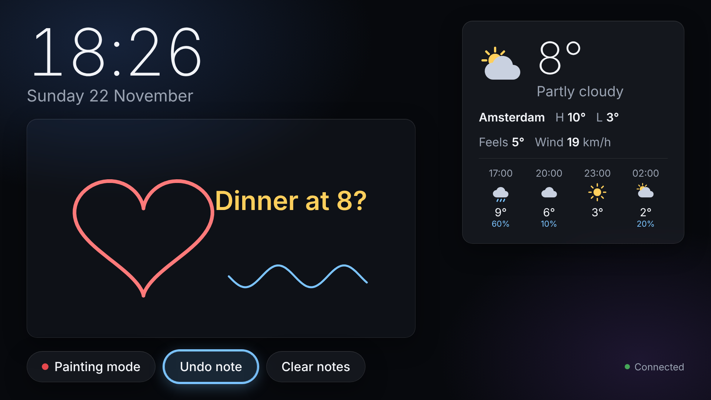

# TV Dashboard

An ad-free, dark, low-power dashboard for a Philips 43PUS7608 (Titan OS) TV.
One small Node server on your network, two web pages:

| Page | URL | Used on |
|---|---|---|
| TV screen | `http://<host-ip>:3000/tv/` | the TV (via cast, HDMI device or Titan DevView) |
| Drawing pad | `http://<host-ip>:3000/phone/` | your phone |

**Current features (Phase 2 MVP):** live phone notes and drawing on the TV, clock,
weather (Open-Meteo, no key), painting mode with night dimming and pixel drift.



## 1. Run it on your laptop

```bash
git clone <this repo> && cd Hadi
npm install                      # installs the one dependency: ws
cp .env.example .env             # optional: change city, port, night-dim times
bash scripts/fetch-paintings.sh  # optional: downloads 5 public-domain paintings
npm start
```

The terminal prints the URLs, for example:

```
TV:    http://192.168.1.20:3000/tv/
Phone: http://192.168.1.20:3000/phone/
```

Open the Phone URL on your Android phone (same Wi-Fi) and draw. If the page will
not load, your laptop firewall blocks port 3000. On Ubuntu: `sudo ufw allow 3000/tcp`.

## 2. Get it onto the TV (try in this order)

### A. Cast a Chrome tab from the laptop (no hardware; your TV showed up as a Cast target)
1. Open Chrome (or Chromium) on the laptop at `http://localhost:3000/tv/`.
2. Menu (⋮) → **Cast…** → **Sources** → **Cast tab** → pick the TV.
3. Press F11 in that tab so it is full screen at 1920x1080.

The laptop renders the page and the TV only shows it. The laptop must stay awake:
`systemd-inhibit --what=idle:sleep --why="TV dashboard" npm start` keeps it up
while the server runs.

### B. An old Android phone as the always-on host (zero cost, try next)
1. Install **Termux** from F-Droid, then `pkg install nodejs git`, clone the repo, `npm install`, `npm start`.
2. In Chrome on that same phone, open `http://localhost:3000/tv/`. Use "Add to Home screen", which opens it full screen.
3. Cast or mirror the phone screen to the TV (quick settings → Cast / Smart View / Screen cast).
4. Keep it plugged in. Developer options → "Stay awake while charging".

### C. Raspberry Pi kiosk (most reliable; buy only if A and B disappoint)
Covered in a later phase: Chromium `--kiosk`, autostart, and HDMI-CEC on/off.

### D. Titan OS DevView (if Titan grants you partner access)
Add `https://…/tv/` as a sandbox app in the Titan Partner Portal. It probably
needs a public HTTPS URL, for example a Cloudflare Tunnel.

## 3. Using it
- **Phone:** Pen or Text tool, 8 colors, 4 brush sizes, Undo, Clear, Painting mode, Next painting.
  Text: type it, then tap where it should go on the board.
- **TV remote / keyboard:** ← → move focus, OK/Enter presses, **red key** or `p` toggles painting mode.
  In painting mode, any key returns to the dashboard.
- **Paintings:** put any `.jpg/.png/.webp` in `public/paintings/`. They rotate every
  `PAINTING_ROTATE_MINUTES`. Names like `10-vermeer-view-of-delft.jpg` become the caption "Vermeer View Of Delft".
- **Night dim:** between `NIGHT_DIM_START` and `NIGHT_DIM_END` the painting gets darker.
- **Auto painting mode:** set `PAINTING_AUTO_START` / `PAINTING_AUTO_END`. Empty = manual only.

## 4. How it works

```
 phone (/phone/) ──draw chunks──▶ Node server ──broadcast──▶ TV (/tv/)
                   WebSocket       state.json               WebSocket
 laptop CLI ─────── POST /api/action ──┘   (same messages, used in Phase 3)
```

| File | What it does |
|---|---|
| `server/index.js` | HTTP server for the pages, `/api/*` endpoints, WebSocket hub, painting schedule |
| `server/state.js` | Holds mode + notes in memory, saves to `data/state.json` (atomic write, size limits) |
| `server/weather.js` | Fetches Open-Meteo, caches 10 min, simplifies the data for the TV |
| `server/config.js` | Reads `.env` with Node's built-in `process.loadEnvFile` |
| `public/shared/ws-client.js` | WebSocket that reconnects by itself and queues messages while offline |
| `public/shared/notes-render.js` | Draws strokes/text on a canvas. Coordinates are 0–1 so the phone and TV match |
| `public/tv/*` | TV layout, clock, weather, painting mode, remote-control focus navigation |
| `public/phone/*` | Drawing pad: pointer events → points → sent every 40 ms |

**Message types** (JSON, WebSocket or `POST /api/action`):
`draw {id,color,size,points}`, `text {id,content,color,size,x,y}`, `undo`, `clear`,
`mode {mode:'home'|'painting'}`, `nextPainting`. The server validates every field before storing.

**Low-power choices:** the clock updates once a minute; there are no CSS animations; painting
mode dims with a black layer instead of a CSS filter; drift is a jump of a few
pixels every 3 minutes, not a continuous animation.

## 5. Tests and screenshots
```bash
npm test             # starts the server, checks pages, live drawing, API, weather
npm run screenshots  # 1920x1080 PNGs in screenshots/ (needs Playwright)
```

## 6. Security note
Anyone on your Wi-Fi can open the phone page and draw on the TV. That is fine
for a home network. Do not port-forward 3000 to the internet. A PIN can be
added later if you want one.

## 7. Rollback / uninstall
Nothing here touches the TV's firmware or settings.
- **Cast:** stop casting in Chrome. The TV returns to its normal screen.
- **Server:** Ctrl+C. Delete the folder to remove everything, including `data/state.json`.
- **Firewall:** `sudo ufw delete allow 3000/tcp` if you opened it.
- **Code:** every step is a git commit. `git log`, then `git checkout <commit>` to go back.
